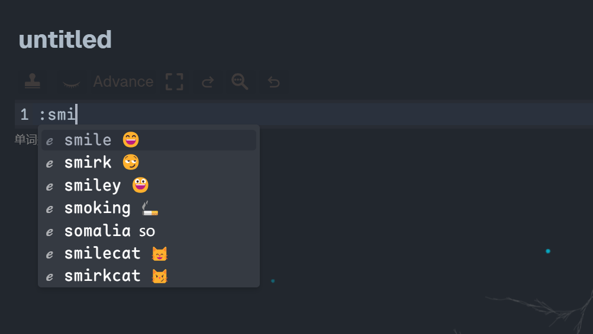
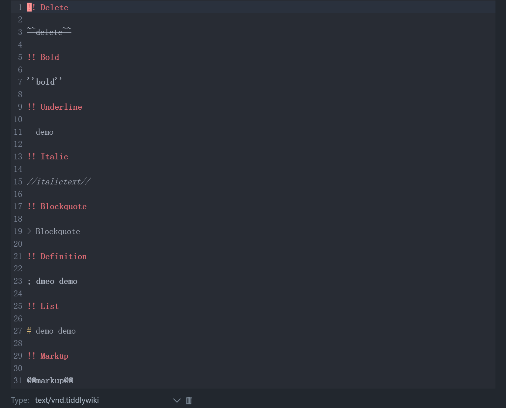
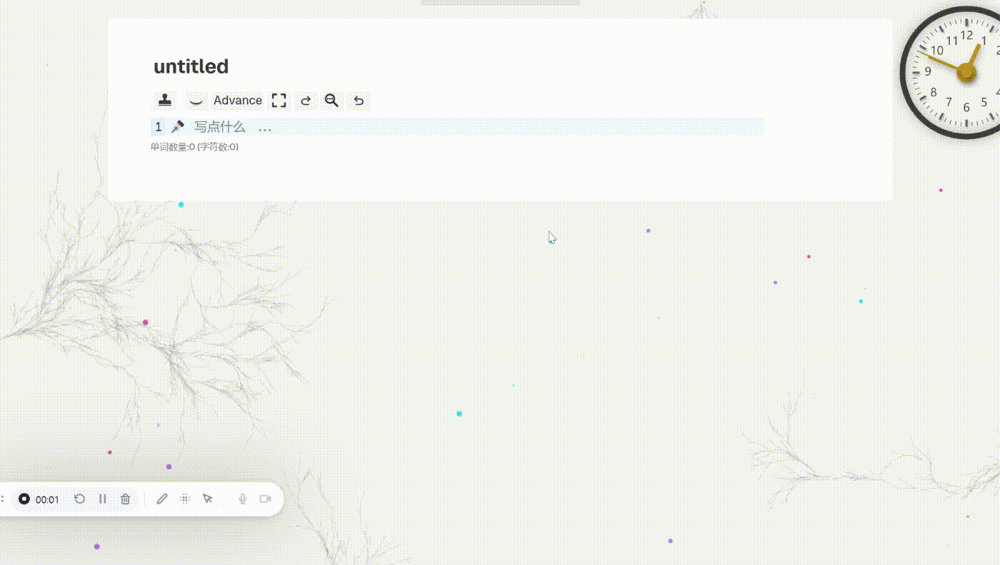
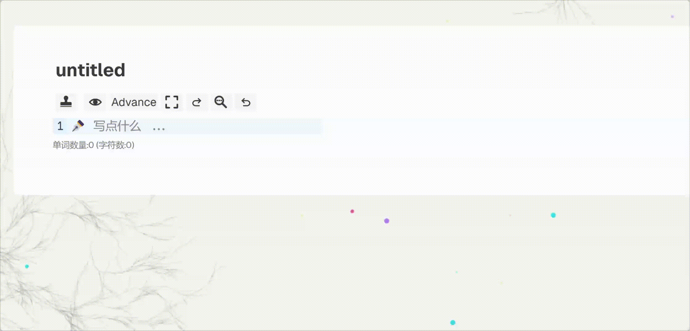
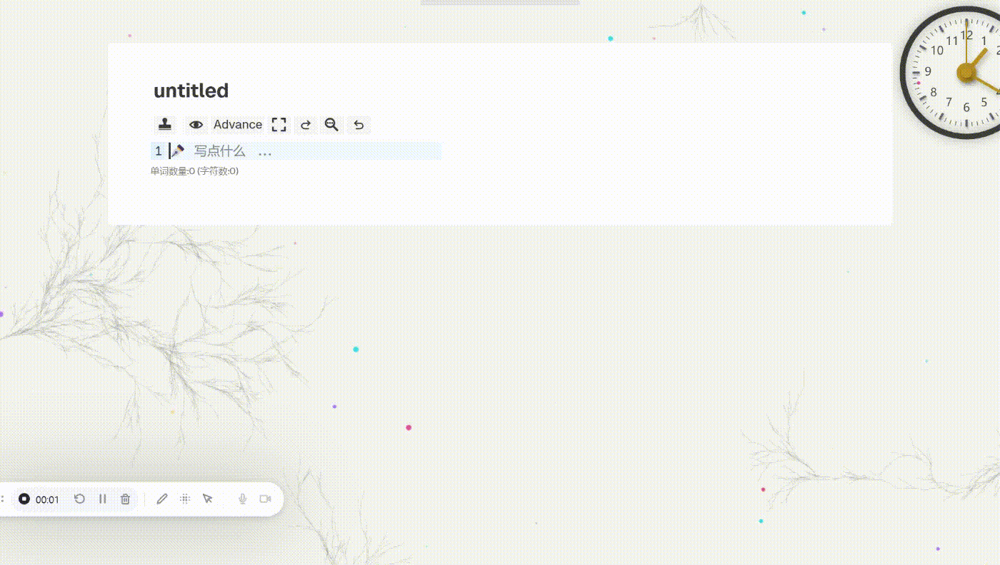
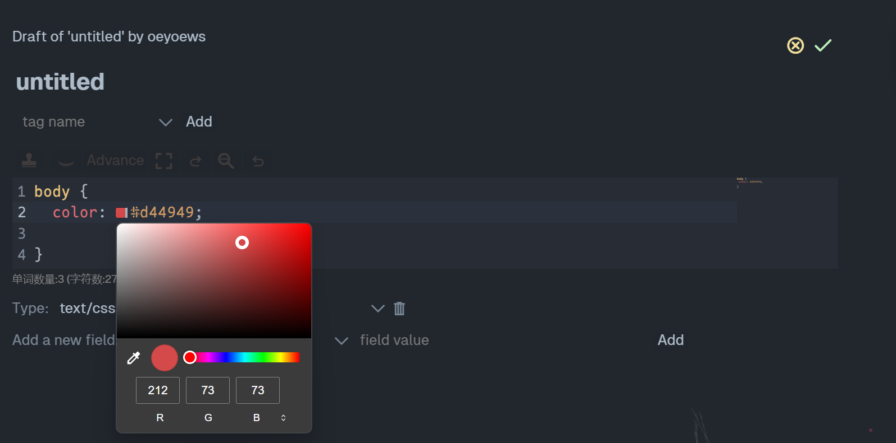
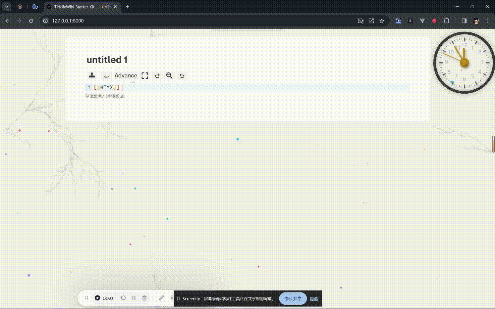

# tiddlywiki-codemirror6

[English](./README.md)

> [!IMPORTANT]
> `tiddlywiki-codemirror-6` 插件已进入维护阶段，后续主要以修复 Bug 和提升兼容性为主，不再进行大的功能改动。如果你想查看最小版本的插件，请切换到 `basic` 分支。

[StackBlitz 演示](https://stackblitz.com/~/github.com/oeyoews/tiddlywiki-codemirror6)

https://user-images.githubusercontent.com/72405338/294956491-948b791f-04e1-4447-a5d3-81ebb13619de.mp4


`tiddlywiki-codemirror6` 是一个面向 TiddlyWiki 的 CodeMirror 6 编辑器插件集合。这个仓库包含主编辑器插件、补全相关的配套插件，以及编辑器依赖的 `lang-tiddlywiki` 语法包。

## 预览

- [Vercel Demo](https://tiddlywiki-codemirror6.vercel.app)
- [GitHub Pages Demo](https://oeyoews.github.io/tiddlywiki-codemirror6)

| Emoji 补全                   | Wiki Mode                           | 代码片段补全                               |
| ---------------------------- | ----------------------------------- | ------------------------------------------ |
|  |  |  |

| tiddler 补全               | widget 补全                    | 图片补全                     |
| -------------------------- | ------------------------------ | ---------------------------- |
|  |  |  |

| 颜色修改                     | Link 预览                                 |
| ---------------------------- | ----------------------------------------- |
|  |  |

## 功能

- 基于 CodeMirror 6 的 TiddlyWiki 5 编辑器
- 面向 WikiText 的补全与编辑增强
- 可按需安装 emoji、icons、snippets 等配套插件
- 支持图片、链接、widget、tiddler 等补全预览
- 集成 Vim mode、minimap、字数统计、彩虹括号、代码块高亮
- 改善 Markdown 和混合内容编辑体验
- 支持自定义 placeholder、tab size 和补全行为

## 仓库结构

当前 monorepo 主要包含以下部分：

- `src/tiddlywiki-codemirror-6`：主 CodeMirror 6 插件
- `src/tiddlywiki-cmp`：补全插件
- `src/tiddlywiki-cmp-emoji`：Emoji 补全插件
- `src/tiddlywiki-cmp-icons`：图标补全插件
- `src/tiddlywiki-snippets`：代码片段插件
- `packages/lang-tiddlywiki`：TiddlyWiki 语言支持包
- `packages/lezer-tiddlywiki`：Lezer 语法包
- `wiki`：本地开发和调试用的 wiki

## 安装

如果你只是想在 TiddlyWiki 中使用插件：

1. 打开最新的 GitHub Release。
2. 下载构建生成的 `dist/*.json` 插件文件。
3. 导入到你的 TiddlyWiki 并启用插件。

如果你还需要额外的补全能力，可以按需安装这些配套插件：

- `tiddlywiki-cmp`
- `tiddlywiki-cmp-emoji`
- `tiddlywiki-cmp-icons`
- `tiddlywiki-snippets`

## 开发

环境要求：

- Node.js `>=16`
- `pnpm`

```sh
git clone --depth 1 https://github.com/oeyoews/tiddlywiki-codemirror6
cd tiddlywiki-codemirror6
pnpm install
pnpm dev
```

常用命令：

```sh
pnpm dev
pnpm build
pnpm build:library
pnpm publish:offline
pnpm update:config
pnpm minify
```

命令说明：

- `pnpm dev`：启动本地 TiddlyWiki 插件开发环境
- `pnpm build`：生成 `dist` 中的插件构建产物
- `pnpm build:library`：构建输出到 `dist/library`
- `pnpm publish:offline`：发布本地离线构建
- `pnpm update:config`：重新生成自动配置 tiddlers
- `pnpm minify`：压缩生成的站点资源

## 发布

- GitHub Actions 会在 `v*.*.*` tag 下构建发布产物
- Release 附件会上传 `dist/*.json`
- GitHub Pages 和 Vercel Demo 用于预览当前编辑器效果

## 备注

- `tips.md` 中保留了一些历史使用说明，但已经不再持续维护
- `src/tiddlywiki-codemirror-6/readme.tid` 是插件内部使用的 wiki 版本说明
- Bug 反馈：[GitHub Issues](https://github.com/oeyoews/tiddlywiki-codemirror6/issues/new)

## 致谢

- BurningTreeC 的 TiddlyWiki CodeMirror 6 插件
